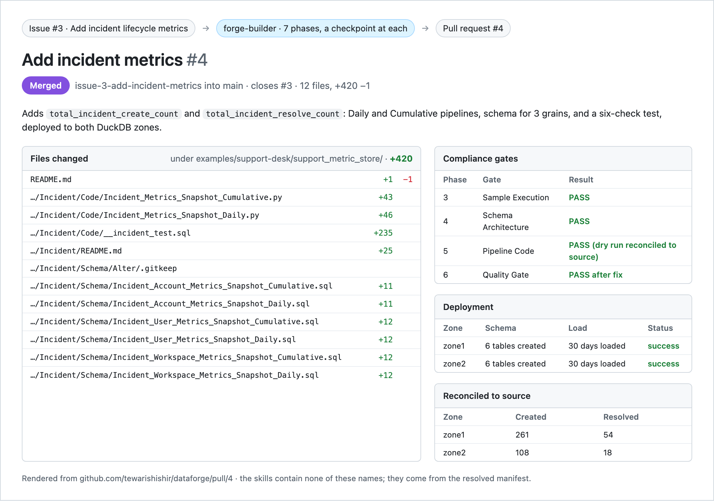
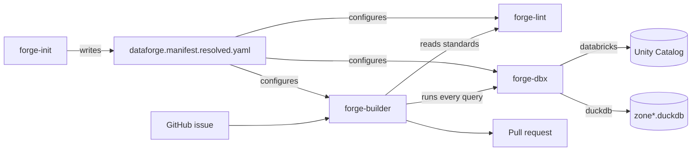

# dataforge

> Reproducao independente para ensaio em
> https://github.com/micheliknechtel/dataforge-demo. O Dataforge original e de
> Shishir Tewari, preservado sob a [licenca MIT](LICENSE).
> Importacao integral de `demos/dataforge` da palestra
> [githubevents/build-once-run-on-any-agent](https://github.com/githubevents/build-once-run-on-any-agent)
> no commit [`2cf8ee86934bbced1217b47f9690b89c4bd4989a`](https://github.com/githubevents/build-once-run-on-any-agent/commit/2cf8ee86934bbced1217b47f9690b89c4bd4989a).
> A palestra registra como origem
> [tewarishishir/dataforge no commit a28b22e1a78423a44d278d79eb2b3892d2fc1108](https://github.com/tewarishishir/dataforge/commit/a28b22e1a78423a44d278d79eb2b3892d2fc1108).
> Nao e trabalho original do proprietario desta copia.
> Issues, labels, branches e PRs do ensaio pertencem exclusivamente a este repo,
> nunca aos repositorios de origem.
>
> One difference: `examples/support-desk` is kept at its unbuilt starting state, so
> [DEMO.md](examples/support-desk/DEMO.md) can build Incident live. The finished
> result is [pull request #4](https://github.com/tewarishishir/dataforge/pull/4).

[](https://github.com/micheliknechtel/dataforge-demo/actions/workflows/checks.yml)
[](LICENSE)

## Comece aqui (ensaio independente)

Na sua maquina, em uma pasta nova:

```bash
git clone https://github.com/micheliknechtel/dataforge-demo.git
cd dataforge-demo
bash scripts/setup-demo.sh
export PATH="$PWD/.tools/bin:$PATH"
node scripts/github.mjs check
copilot --agent forge-init
```

No Copilot, diga: **"initialize dataforge; use o projeto selecionado pelo
workspace e pare para eu revisar o resumo"**. Depois siga o
[roteiro em portugues](examples/support-desk/DEMO.md). O setup nao cria issues,
labels ou PRs e nao constrói Incident. O agente exige suas revisoes nas fases.
DuckDB usa dados ficticios locais; GitHub e Copilot exigem login e permissao.
Se faltar autenticacao: `gh auth login --hostname github.com` e `copilot login`.

O setup usa DuckDB existente no PATH ou baixa o CLI oficial **v1.4.1**, com
SHA-256 verificado, em `.tools/bin/`; nao instala pacotes globais nem usa PyPI.
Cada novo terminal precisa do `export PATH` acima. Reexecutar o setup preserva
bancos existentes; `--reseed` reconstrói apenas os dois bancos sinteticos.
Para repetir o roteiro inteiro, prefira um clone novo, sem apagar seu trabalho.

Abra **a raiz do repositorio**, nao apenas `examples/support-desk`, no VS Code:
`code .` (ou File > Open Folder). No chat do Copilot procure os agentes
`forge-init`, `forge-builder`, `forge-dbx` e `forge-lint` no seletor de agentes.
Os arquivos estao em `.github/agents/`; as skills em `.github/skills/`.
Se sua versao nao mostrar os agentes, atualize a extensao ou use o CLI acima.
O fluxo no VS Code e a plataforma Databricks nao foram executados nesta preparacao.

`dataforge.workspace.json` aponta para o seed do exemplo. O resolver funciona
na raiz e no subdiretorio; o manifest generico em `assets/` nao configura este
ensaio. Os hooks Claude/Cursor so verificam existencia e emitem um aviso:
**nao leem o conteudo do manifest e nao executam forge-init**.

As instrucoes e pacotes originais seguem abaixo para referencia. A imagem do
PR mostra uma execucao historica do autor, nao uma execucao desta copia.

**Verificado nesta preparacao:** setup oficial isolado e sua repeticao sem
recriar bancos existentes; duas zonas com tres tabelas de origem e seis tabelas
Ticket cada; reconciliacao de Ticket para os tres grains; runners imprimindo
SQL; descoberta das quatro skills pelo CLI na raiz e no exemplo; resolucao de
caminhos, bloqueio de destinos GitHub externos, hooks e contratos existentes.
**Nao executado:** fluxo completo do agente, criacao da issue/PR de Incident,
deploy de Incident, VS Code ou Databricks. Esses passos ficam no seu roteiro,
com os checkpoints humanos preservados.

Four agent skills that build data pipelines, with no knowledge of your data in
any of them.

Everything the skills need to know about a specific business — its zones,
catalogs, domains, entities, grains, job names, and naming grammar — lives in
one generated manifest. The skills read it. They never contain it. That
boundary is what makes the same skills work across two different data
platforms, and it is also why this repository could be published at all.

[](https://github.com/tewarishishir/dataforge/pull/4)

That is a real run. [Issue #3](https://github.com/tewarishishir/dataforge/issues/3)
asked for incident metrics; `forge-builder` produced
[pull request #4](https://github.com/tewarishishir/dataforge/pull/4). Run it
yourself with [DEMO.md](examples/support-desk/DEMO.md).

```bash
bash scripts/setup-demo.sh
export PATH="$PWD/.tools/bin:$PATH"
```

Open the repository root and say `initialize dataforge`. DuckDB needs no
cloud credentials; GitHub and Copilot require authentication. [DEMO.md](examples/support-desk/DEMO.md)
walks the whole thing from a GitHub issue to a pull request.

## The skills

| Skill | Does | Read |
| --- | --- | --- |
| [`forge-init`](skills/forge-init/) | Turns an eight-line seed config into the full project manifest by inspecting the warehouse and the codebase | [SKILL.md](skills/forge-init/SKILL.md) |
| [`forge-dbx`](skills/forge-dbx/) | One interface over the data platform: auth, queries, jobs, catalogs. Databricks or DuckDB | [SKILL.md](skills/forge-dbx/SKILL.md) |
| [`forge-lint`](skills/forge-lint/) | The standards — naming, SQL formatting, join strategy, safety gates — as a skill rather than a wiki page | [SKILL.md](skills/forge-lint/SKILL.md) |
| [`forge-builder`](skills/forge-builder/) | Composes the other three into a seven-phase build, issue to PR, with a human checkpoint at each phase | [SKILL.md](skills/forge-builder/SKILL.md) |



## Four ideas worth stealing

**A config boundary, enforced.** One file holds the business context; no skill
hardcodes a catalog, a table, or a domain word. The test is whether you can
open-source the skills without a rewrite. These passed it.

**Discovery over declaration.** `forge-init` infers grains from schema
filenames and metric grammar from existing pipeline code, rather than asking a
human to write it down twice. What it cannot discover, it marks unsupported
instead of guessing.

**One execution primitive.** Every query in every skill goes through
`forge-dbx`. Swapping Databricks for DuckDB is a one-line manifest change
because nothing else ever learned what a platform is.

**Rules as a skill, not a document.** `forge-lint` is loaded before any code is
written, so the standards are an input to generation rather than a comment left
on the pull request afterward.

## Install

The skills are plain Markdown and work with any agent that can read files.

```bash
git clone https://github.com/micheliknechtel/dataforge-demo.git
```

Claude Code can install from this repository directly:

```bash
claude plugin marketplace add micheliknechtel/dataforge-demo
claude plugin install dataforge@dataforge
```

| Agent | Points at |
| --- | --- |
| Claude Code | `.claude-plugin/plugin.json` |
| Cursor | `.cursor-plugin/plugin.json` |
| GitHub Copilot | `.github/agents/*.agent.md` |
| Copilot project skills | `.github/skills/*/SKILL.md` |

The agent packages and `.claude-plugin/marketplace.json` are generated from
`skills/*/SKILL.md` by `node scripts/package.mjs`. CI fails if they drift, so
the source stays single.

## Status

Beta. The DuckDB adapter and the GitHub Issues intake are new in
[`0.1.0`](https://github.com/tewarishishir/dataforge/releases/tag/v0.1.0) and
are exercised by the example project rather than by production use.

- [Changelog](CHANGELOG.md)
- [Contributing](CONTRIBUTING.md)
- [Adopters](ADOPTERS.md)
- [Cite this project](CITATION.cff)
- [Issues do ensaio](https://github.com/micheliknechtel/dataforge-demo/issues)

MIT licensed.
